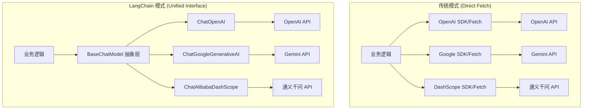

作为一个前端开发，当我们开始接触 AI 后端开发时，最先碰到的问题往往是：这么多模型，每个接口都不一样，难道我要写一堆 fetch 请求吗。

今天我们就从最基础的“模型接入”聊起，看看 LangChain 是如何用一套标准接口抹平差异的。

## 过去：手动处理 fetch 请求的混乱

在没有 LangChain 之前，如果你想接入 Google 的 Gemini 或者阿里的通义千问，你可能得这么写：

```typescript
// 伪代码示例：直接调用 API
async function getGeminiResponse(prompt: string) {
  const res = await fetch(
    "https://generativelanguage.googleapis.com/v1beta/models/gemini-pro:generateContent",
    {
      method: "POST",
      body: JSON.stringify({
        contents: [{ parts: [{ text: prompt }] }],
      }),
      headers: { "Content-Type": "application/json" },
    },
  );
  const data = await res.json();
  return data.candidates[0].content.parts[0].text;
}
```

这种写法有几个明显的痛点：

1. **接口协议不统一**。Google 用 `contents`，OpenAI 用 `messages`，换个模型就要改逻辑。
2. **基础功能重复造轮子**。超时重试、流式传输、错误处理，每个接口都要手写一遍。
3. **难以维护**。当你想给项目增加多模型切换策略时，代码会变得非常臃肿。

## 架构对比：从混乱到统一

我们可以通过下面的流程图直观地看到 LangChain 带来的改变。



## 深度解析：BaseChatModel 的技术原理

LangChain 提供了一个核心抽象类：`BaseChatModel`。它不仅仅是一个简单的包装，而是一套完整的协议转换系统。

### 1. 消息协议的标准化 (Message Mapping)

每个模型对“对话历史”的定义都不同。OpenAI 使用 `role: user/assistant/system`，而 Google Gemini 使用 `role: user/model`。

`BaseChatModel` 内部定义了一套标准的消息类：

- `HumanMessage`: 用户发送的消息。
- `AIMessage`: 模型返回的消息。
- `SystemMessage`: 系统指令。

当你调用 `model.invoke([new HumanMessage("Hello")])` 时，LangChain 内部的各个实现类（如 `ChatOpenAI`）会负责将这些标准对象“翻译”成对应厂商能理解的 JSON 格式。

### 2. 核心方法的抽象

`BaseChatModel` 强制要求子类实现 `_generate` 方法。这是模型接入的核心。

- **输入转换**：将 LangChain 的消息数组转换为厂商特定的输入格式。
- **网络请求**：处理底层的 HTTP 通信。
- **输出解析**：将厂商返回的杂乱 JSON 提取出核心文本，封装成统一的 `ChatResult` 对象。

这种设计模式让开发者可以像使用插件一样切换模型，而不需要关心底层的实现细节。

## 为什么前端开发者更需要统一接口？

从前端视角来看，后端使用 LangChain 带来的好处是巨大的。

1. **数据结构的可预测性**。无论后端换了什么模型，返回给前端的 JSON 结构可以保持完全一致。这减少了前端处理各种“奇葩”字段的逻辑。
2. **流式传输的标准化**。LangChain 对流式输出（Streaming）有很好的封装。前端可以使用一套通用的 SSE（Server-Sent Events）处理逻辑来展示打字机效果。
3. **快速原型验证**。如果你发现 Gemini 在某个场景下表现不好，后端只需要改一行配置就能换成 GPT-4。前端甚至不需要刷新页面就能看到新模型的效果。

## 实战：封装 AgentProviderService

为了让模型接入更工程化，我们可以仿照 NestJS 的 Service 模式，将初始化逻辑封装在一个统一的服务中。

```typescript
import { ChatGoogleGenerativeAI } from "@langchain/google-genai";
import { ChatAlibabaDashScope } from "@langchain/community/chat_models/alibaba_dashscope";
import { Injectable } from "@nestjs/common";
import { ConfigService } from "@nestjs/config";

@Injectable()
export class AgentProviderService {
  constructor(private configService: ConfigService) {}

  getModel(provider: "google" | "ali", temperature: number) {
    if (provider === "google") {
      return new ChatGoogleGenerativeAI({
        apiKey: this.configService.get("GOOGLE_API_KEY"),
        model: "gemini-pro",
        temperature,
      });
    }

    return new ChatAlibabaDashScope({
      apiKey: this.configService.get("DASHSCOPE_API_KEY"),
      modelName: "qwen-turbo",
      temperature,
    });
  }
}
```

这样做的好处是显而易见的。业务层只需要调用 `agentProviderService.getModel('google', 0.7)`，拿到的就是一个具备标准能力的模型实例。

## 开启对话：invoke 基础调用

有了模型实例后，最简单的对话方式就是使用 `invoke` 方法。

```typescript
const model = agentProviderService.getModel("google", 0.3);

// 传入字符串，或者 BaseMessage 数组
const response = await model.invoke("你好，请简要介绍一下 React Hooks。");

// 无论底层是什么模型，这里拿到的 response.content 永远是字符串
console.log(response.content);
```

`invoke` 是一个异步操作，它会等待模型生成完整的回复后返回。对于简单的单次问答，这已经足够了。

如果你追求更流畅的用户交互，比如流式输出效果，LangChain 还提供了 `stream` 方法，我们会在后续的篇章中详细介绍。

## 总结

对于前端转型 AI 开发的同学来说，理解 LangChain 的抽象模式是核心。不要再纠结于具体的 API 格式，学会使用 `BaseChatModel` 提供的标准能力。

通过这种方式，我们不仅统一了接口协议，更重要的是，我们建立了一套可扩展、易维护的 AI 应用架构。

下一篇，我们将聊聊如何给 AI 喂“历史记忆”，实现多轮对话。
