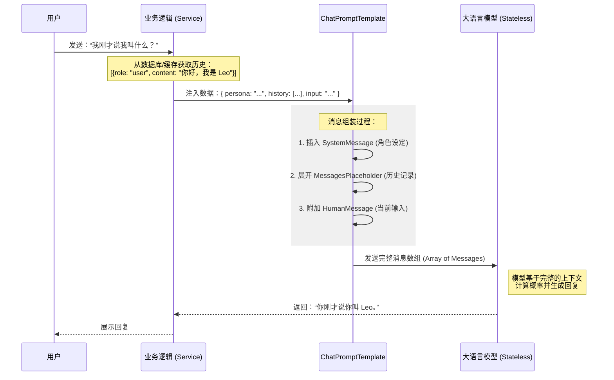

# 对话历史管理：探索 Prompt 模板与上下文维护

前端工程师在接触 LangChain 后端开发时，最先遇到的挑战通常不是模型本身，而是如何管理对话。当模型表现出无状态特性时，就需要理解状态管理的重要性。

### 1. 深度解析：为什么 LLM 是“无状态”的？

在深入代码之前，我们必须理解大语言模型（LLM）的底层逻辑。

#### 1.1 变换器（Transformer）的本质

主流的 LLM（如 GPT-4, Claude）都基于 Transformer 架构。从数学角度看，模型本质上是一个复杂的**函数**：`y = f(x)`。

- **无状态性**：模型在处理请求时，并不会在服务器端“存储”你的对话状态。每一次 API 调用都是完全独立的。
- **自注意力机制（Self-Attention）**：模型通过计算输入序列中各个 Token 之间的权重关系来理解语义。它只能“看到”你当前发送给它的这一段文字。

#### 1.2 上下文窗口（Context Window）与 Token 限制

既然模型没有记忆，我们只能通过“复读”历史记录来模拟记忆。这就引出了两个核心限制：

- **Token 限制**：Token 是模型处理的最小单位（通常 1000 个 Token 约等于 750 个英文单词）。模型对单次处理的 Token 总数有硬性上限。
- **计算成本**：随着对话历史变长，每次请求发送的 Token 越来越多。由于 Transformer 的计算复杂度通常与序列长度的平方成正比（或通过优化达到线性），长文本不仅意味着更高的 API 费用，还意味着更长的响应延迟。

### 2. 消息流转：ChatPromptTemplate 的组装逻辑

在 LangChain 中，`ChatPromptTemplate` 负责将零散的系统设定、历史记录和用户输入组装成模型能理解的结构化数据。

我们可以通过下面的序列图观察这个过程：



### 3. 模板对比：PromptTemplate vs ChatPromptTemplate

很多初学者会混淆这两者，它们的应用场景有着本质区别：

| 特性         | PromptTemplate                            | ChatPromptTemplate                          |
| :----------- | :---------------------------------------- | :------------------------------------------ |
| **数据格式** | 纯字符串 (String)                         | 消息对象数组 (Message Objects)              |
| **底层原理** | 基于 f-string 或 mustache 模板拼接        | 基于角色（System, Human, AI）的结构化组合   |
| **适用模型** | 传统的补全模型 (LLMs, 如 text-davinci)    | 现代对话模型 (ChatModels, 如 gpt-4, claude) |
| **角色管理** | 需要手动拼接 `User:` 或 `Assistant:` 标签 | 自动适配不同厂商的角色标签格式              |
| **灵活性**   | 适合单次任务指令                          | 适合需要维护上下文的复杂对话                |

### 4. 结构化 Prompt 构建

在没有 LangChain 之前，手动拼接 Prompts 存在隐患：

```typescript
// ❌ 错误示范：手动拼接
const history = ["User: 你好，我是 Leo。", "AI: 你好 Leo！"];
const currentInput = "我叫什么？";
const fullPrompt = `你是一个助手。\n${history.join("\n")}\nUser: ${currentInput}`;
```

这种做法的隐患在于：

1.  **角色标签不统一**：不同模型对 `Human:`、`User:` 或 `[INST]` 的要求各异。
2.  **注入风险**：简单的字符串拼接容易受到 Prompt Injection 攻击。
3.  **难以维护**：当需要加入复杂的 `System Message` 或 `Function Call` 结果时，字符串会变得混乱。

### 5. 实战代码：AgentPromptService 的结构化实现

在生产环境中，我们通常封装一个 Service。下面的例子展示了如何利用 `MessagesPlaceholder` 处理动态历史记录。

```typescript
import {
  ChatPromptTemplate,
  MessagesPlaceholder,
} from "@langchain/core/prompts";
import { HumanMessage, AIMessage } from "@langchain/core/messages";

class AgentPromptService {
  /**
   * 构造 Agent 所需的结构化 Prompt
   * @param persona 角色设定（System Prompt）
   * @param history 原始历史记录
   * @param input 当前用户输入
   */
  static async buildAgentPrompt(
    persona: string,
    history: { role: "user" | "assistant"; content: string }[],
    input: string,
  ) {
    // 1. 将业务数据映射为标准的 Message 对象
    const historyMessages = history.map((item) => {
      return item.role === "user"
        ? new HumanMessage(item.content)
        : new AIMessage(item.content);
    });

    // 2. 定义结构化模板
    // MessagesPlaceholder 会在指定位置“展开”消息数组
    const promptTemplate = ChatPromptTemplate.fromMessages([
      ["system", persona],
      new MessagesPlaceholder("chat_history"),
      ["human", "{input}"],
    ]);

    // 3. 格式化并生成最终的消息数组
    return await promptTemplate.formatMessages({
      chat_history: historyMessages,
      input: input,
    });
  }
}
```

### 6. 技术要点总结

1.  **类型安全**：通过 `HumanMessage` 和 `AIMessage` 确保了数据流向模型时的格式严谨性。
2.  **解耦设定**：`persona` 变量允许我们在不改动代码逻辑的情况下，动态切换 AI 的性格（如从“技术顾问”切换为“幽默助手”）。
3.  **占位符机制**：`MessagesPlaceholder` 解决了历史记录长度不确定的问题，它会自动处理数组的展开与注入。

掌握了 Prompt 模板与对话历史的管理，就完成了从“调用 API”到“构建复杂 AI 系统”的核心环节。在下一篇笔记中，我们将研究如何引入数据库（如 Redis 或 PostgreSQL）来持久化这些对话历史。
