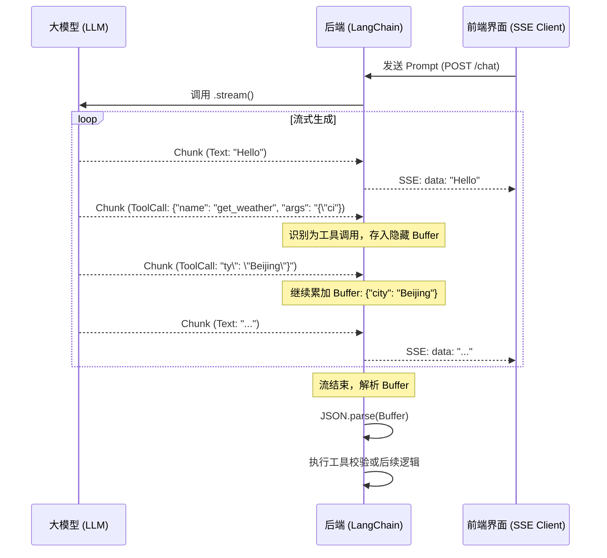

作为前端工程师，我们对响应式体验有着高度关注。但在进入大模型（LLM）后端开发领域后，你会面临一个技术挑战：首字节时间（TTFB）极长。

如果按照传统的 HTTP 请求/响应模式，一个复杂的逻辑链条，涉及多个工具调用和数百个 Token 生成，可能需要 10 秒甚至更久才能返回。在现代 Web 应用中，让用户盯着加载动画看 10 秒是不可接受的。

本篇笔记将深入探讨如何通过 LangChain 的流式响应机制，结合 Server-Sent Events (SSE)，为前端提供流式输出交互。

## 1. 为什么 LLM 必须使用流式输出？

在传统的 REST API 中，后端需要生成完整的 JSON 对象后再统一返回。对于 LLM 而言，这意味着：

1. 后端调用 LLM。
2. LLM 逐个 Token 生成内容，这个过程非常耗时。
3. LLM 完成生成。
4. 后端接收完整字符串。
5. 后端将结果返回给前端。

这种模式会导致严重的卡顿感。用户在等待的前几秒往往会怀疑程序是否已经崩溃。流式输出的核心价值在于降低感知延迟。虽然总生成时间没有变短，但用户从第 1 秒就开始看到内容，这种即时反馈提升了交互体验。

## 2. 深度解析：SSE vs WebSockets

要实现流式传输，我们通常在 SSE 和 WebSockets 之间做选择。虽然两者都能实现服务端推送，但在 LLM 场景下，SSE 往往是更优解。

### Server-Sent Events (SSE) 的优势

SSE 是一种基于 HTTP 的单向流技术。它允许服务端向客户端推送文本数据，而不需要客户端不断轮询。

- **协议简单**：SSE 运行在标准的 HTTP 协议之上，不需要像 WebSockets 那样进行复杂的协议升级（Handshake）。
- **轻量化**：它只支持服务端到客户端的单向通信。对于 LLM 这种“客户端发一个 Prompt，服务端回一长串 Token”的场景，单向通信完全足够。
- **自动重连**：浏览器内置了对 SSE 的重连支持。如果连接中断，浏览器会自动尝试重新连接。
- **防火墙友好**：因为它就是普通的 HTTP 请求，不容易被公司防火墙或代理服务器拦截。

相比之下，WebSockets 是全双工的，适合实时游戏或多人协作编辑。但它维护成本更高，且在某些网络环境下不够稳定。

## 3. 核心技术：AsyncGenerator (`async function*`)

在 JavaScript 中，处理流式数据的最佳抽象是 `AsyncGenerator`。如果你不熟悉这个概念，可以把它理解为“可以多次产出结果的异步函数”。

### 语法解析

普通的异步函数使用 `async` 关键字并返回一个 `Promise`。一旦 `return`，函数就结束了。
而异步生成器使用 `async function*` 语法，配合 `yield` 关键字，可以在执行过程中多次向外“吐”出数据。

```typescript
async function* tokenGenerator() {
  yield "Hello";
  await new Promise((resolve) => setTimeout(resolve, 500));
  yield "World";
}

// 消费方式
for await (const chunk of tokenGenerator()) {
  console.log(chunk); // 先打印 Hello，半秒后打印 World
}
```

LangChain 的 `.stream()` 方法返回的就是一个类似的异步迭代器。它封装了底层的流式逻辑，让我们能用简洁的 `for await` 循环处理每一个 Token。

## 4. 双轨处理：UI 展示与逻辑累加

在复杂的 Agent 场景中，LLM 不仅仅在输出文字，它还可能在生成工具调用的参数（Tool Calls）。这里存在一个有趣的矛盾：

1.  **展示轨**：我们需要尽快把文字 `yield` 出去，让用户看到。
2.  **逻辑轨**：工具调用的参数通常是分段生成的 JSON 字符串。在参数完全生成之前，我们无法解析它，更无法执行工具。

我们需要在循环中进行双轨处理：一边把可见字符吐给前端，一边在后台默默累加那些不可见的工具调用参数。

### 流程示意图



## 5. 实战代码：封装 AgentChatService

下面是一个生产级别的封装示例。它展示了如何利用 `AsyncGenerator` 将流式数据透传给控制器，同时处理隐藏的工具调用逻辑。

```typescript
import { ChatOpenAI } from "@langchain/openai";

export class AgentChatService {
  /**
   * 核心聊天逻辑：返回一个异步生成器
   */
  async *chatStream(userInput: string): AsyncGenerator<string> {
    const model = new ChatOpenAI({
      modelName: "gpt-4-turbo",
      streaming: true, // 必须开启流模式
    });

    const stream = await model.stream(userInput);

    let toolCallArguments = "";
    let isCollectingToolCall = false;

    for await (const chunk of stream) {
      // 1. 处理文字输出（展示轨）
      if (chunk.content) {
        yield chunk.content as string;
      }

      // 2. 处理工具调用（逻辑轨）
      // 注意：OpenAI 的工具调用参数是分段传输的
      const toolCall = chunk.additional_kwargs.tool_calls?.[0];
      if (toolCall) {
        isCollectingToolCall = true;
        // 默默累加参数片段，不 yield 给前端
        toolCallArguments += toolCall.function?.arguments || "";
      }
    }

    // 3. 后期校验：流结束后，尝试解析完整的工具参数
    if (isCollectingToolCall) {
      try {
        const finalArgs = JSON.parse(toolCallArguments);
        console.log("工具调用参数累加完成，开始执行校验...", finalArgs);
        // 在这里可以执行数据库查询、权限校验等逻辑
      } catch (e) {
        console.error("参数解析失败，可能是 LLM 生成的 JSON 格式有误", e);
      }
    }
  }
}
```

## 总结

实现流式输出不仅是技术上的改变，更是产品思维的转变。

作为前端转后端的工程师，我们要习惯这种碎片化的数据处理流程。通过 `AsyncGenerator` 封装 Service，再配合 SSE 推送到前端，我们可以将原本长达 10 秒的阻塞等待，转化为从第 1 秒就开始的交互。

这种流式输出的交互特性，是大模型应用提升用户体验的核心要素。掌握了 SSE 和异步生成器，你就掌握了构建高性能 AI 应用的基础。
