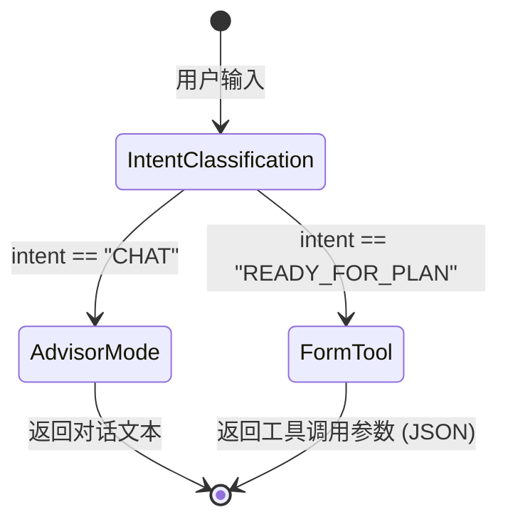

作为一个前端开发，你可能习惯了 LLM 作为一个高效的对话助手。但当你希望大模型不仅是对话，还能执行任务的时候，你就进入了智能体（Agent）的领域。

### 什么是 Agent：大模型作为推理引擎

智能体与普通 LLM 的本质区别在于决策能力。如果说 LLM 是一个知识渊博的顾问，那么 Agent 就是一个具备工具调用能力、能根据实际情况决定下一步操作的执行单元。

在技术底层，Agent 的公式可以概括为：**Agent = LLM + 规划 + 记忆 + 工具使用**。

1.  **推理引擎 (Reasoning Engine)**：LLM 不再只是生成文本，而是负责分析当前状态，判断是否需要外部支持。
2.  **意图路由 (Intent Routing)**：根据用户输入，将请求分发到不同的处理逻辑或工具。
3.  **工具执行 (Tool Execution)**：模型输出结构化的参数，由程序调用 API 或函数，并将结果反馈给模型。

### ReAct 模式：思考与行动的循环

虽然我们在简单的业务中可能只用到单次路由，但理解 **ReAct (Reasoning and Acting)** 模式是掌握 Agent 的关键。ReAct 是一种让模型交替生成“推理轨迹”和“特定任务操作”的提示技术。

其核心逻辑是：

- **Thought (思考)**：模型描述当前情况及下一步打算。
- **Action (行动)**：模型选择要调用的工具。
- **Observation (观察)**：模型读取工具返回的结果。

这种循环让模型能处理多步拆解的任务。即使在简单的意图识别中，我们也借鉴了这种思想：先判断意图（思考），再决定是直接回复还是调用工具（行动）。

### 意图识别：请求路由分发

在构建复杂的后端业务逻辑时，我们不能把用户的所有输入都直接丢给对话接口。我们需要第一层过滤：意图识别（Intent Classification）。

通过 LangChain 的结构化输出能力，我们可以定义一个 `classifyIntent` 函数，让模型判断用户的意图。

```typescript
import { z } from "zod";
import { ChatOpenAI } from "@langchain/openai";

const IntentSchema = z.object({
  intent: z.enum(["CHAT", "READY_FOR_PLAN", "ASK_QUESTION"]),
  confidence: z.number(),
});

async function classify(input: string) {
  const model = new ChatOpenAI({ modelName: "gpt-4o" });
  const structuredModel = model.withStructuredOutput(IntentSchema, {
    name: "classifyIntent",
  });

  return await structuredModel.invoke(input);
}
```

我们可以用状态机来描述这种路由逻辑：



### 工具绑定：`bindTools` 的底层原理

Tool Calling 是 Agent 的核心。在代码层面，这通过 `model.bindTools([tool])` 实现。

```typescript
import { tool } from "@langchain/core/tools";

const weatherTool = tool(
  async ({ city }) => {
    return `The weather in ${city} is sunny.`;
  },
  {
    name: "get_weather",
    description: "获取指定城市的实时天气",
    schema: z.object({
      city: z.string(),
    }),
  },
);

const modelWithTools = model.bindTools([weatherTool]);
```

#### 模型是如何决定“闭嘴”并开始调用工具的？

当你调用 `bindTools` 时，LangChain 会将你的 Zod Schema 转换成模型供应商（如 OpenAI）定义的 JSON Schema 格式，并随 Prompt 一起发送。

1.  **概率预测**：模型在生成下一个 Token 时，会计算“继续说话”和“调用工具”的概率。如果 Prompt 明确提到需要天气信息，且存在 `get_weather` 工具，模型生成工具调用标识符（如 `<|tool_call|>`）的概率会远高于普通文本。
2.  **停止序列 (Stop Sequences)**：一旦模型决定调用工具，它会停止生成常规回复，转而输出符合 Schema 要求的 JSON 字符串。
3.  **强制约束**：在某些模式下，我们可以强制模型必须调用某个工具，这在处理特定业务表单时非常有用。

### 动态表单生成：Agent 在业务中的闭环

在 `AgentChatService` 中，处理工具调用是一个动态的过程。当模型决定调用某个工具时，它会输出工具需要的参数。

我们可以利用 Zod 来校验这些参数，并在后端触发逻辑。如果这个工具需要用户手动确认（比如确认一个项目计划），后端可以暂停对话，直接给前端发回一个动态生成的表单。

```typescript
// AgentChatService 中的核心处理逻辑
async function handleChat(userInput: string) {
  const response = await modelWithTools.invoke(userInput);

  if (response.tool_calls && response.tool_calls.length > 0) {
    for (const call of response.tool_calls) {
      if (call.name === "generate_project_plan") {
        // 解析 Zod 校验后的参数
        const planData = call.args;

        // 触发后端逻辑，同时通知前端展示“确认计划”的动态表单
        return {
          type: "DYNAMIC_FORM",
          formType: "PROJECT_PLAN",
          data: planData,
        };
      }
    }
  }

  return { type: "TEXT", content: response.content };
}
```

这种模式降低了开发复杂度。你不需要硬编码每一个业务流程，而是由 Agent 根据对话上下文动态决定何时触发 UI 组件的更新。

### 总结

从大模型扩展到 Agent，本质上是给 AI 加上了执行能力与推理能力。

1.  **意图识别** 解决了“去哪里”的问题。
2.  **工具调用** 解决了“怎么做”的问题。
3.  **结构化参数** 则保证了前后端交互的严谨性。

理解了这几点，你就掌握了构建现代 AI 原生应用的核心原理。
