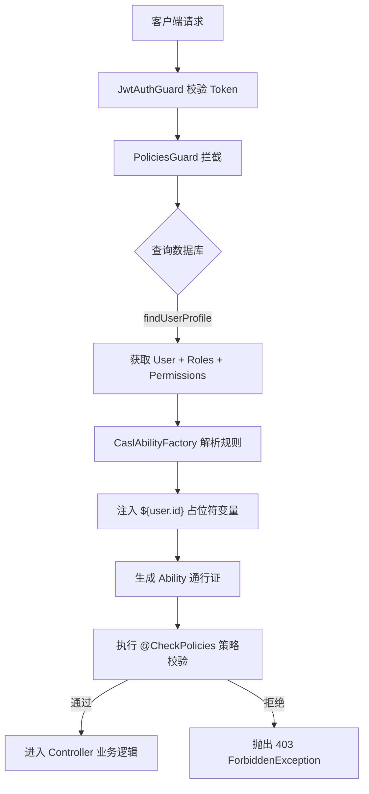

在构建后台管理系统或企业级 SaaS 应用时，权限控制（Authorization）是核心需求。传统的基于角色的访问控制 (RBAC) 在面对“用户只能编辑自己的文章”这种行级数据权限时，能力受限。

本文介绍如何利用 NestJS 与 CASL (`@casl/ability`)，构建一套基于数据库驱动的 ABAC (基于属性的访问控制) 系统，实现从后端接口拦截到前端 UI 按钮的动态控制，并探讨设计过程中的决策。

## 1. 架构演进：从 RBAC 到 ABAC

### RBAC 的局限性

在 RBAC 模式下，权限通常硬编码在路由装饰器中：

```typescript
@Roles('ADMIN') // 只有管理员能访问
@Get('/users')
findAllUsers() {}
```

这种方式粒度较粗，无法处理细粒度的业务逻辑。例如，普通用户可以访问“更新文章”接口，但只能更新属于自己的文章。如果直接在业务代码中使用 if 判断，权限逻辑会分散在各处，难以维护。

### ABAC 的优势

ABAC 允许定义独立于业务代码的规则：

> **允许** `User` 对 `Article` 执行 `Update` 操作，前提是 `Article.authorId === User.id`。

通过 CASL，可以将这些规则持久化到数据库并在运行时动态解析，使权限系统与业务逻辑解耦。这实现了“数据即权限”，并允许非技术人员通过管理后台调整系统规则。

## 2. 核心链路设计

鉴权流程如下：



## 3. 数据库实体设计与 UI 交互的权衡

为了实现动态配置，权限规则由 `action`（动作）、`subject`（资源）和 `conditions`（JSON 条件）组成。设计时需要进行架构抉择。

### 抉择：UI 多选与数据库单行原子化

在用户体验上，管理员配置权限时常用的交互方式为：

- 勾选模块：`User`
- 勾选动作：`[read, create, update, delete]`
- 填写条件：`{"id": "${user.id}"}`

如果数据库按 `actions: string[]` 的 JSON 数组存储，会产生以下问题：

1. **条件耦合（Condition Entanglement）**：若将多个动作合并在一行，会导致所有动作受限于同一个条件。
2. **规则冲突（Inverted Rules）**：CASL 的 `cannot`（禁止）规则需要精确控制。如果动作是数组，一个 `cannot` 会限制所有操作。
3. **查询性能**：关系型数据库不擅长对 JSON 数组中的元素进行索引查询，会产生性能瓶颈。

### 解决方案：前端多选与后端单行原子化

系统采用前端表单多选、后端接口拆解、数据库单行原子化的架构。

#### 数据库原子实体

```typescript
// apps/server/src/permission/permission.entity.ts
@Entity()
export class Permission {
  @PrimaryGeneratedColumn()
  id: number;

  @Column({ comment: "权限名称" })
  name: string;

  @Column({ comment: "操作类型: 一行只能有一个 action，如 update" })
  action: string;

  @Column({ comment: "资源对象: User, Article, all" })
  subject: string;

  @Column({
    type: "json",
    nullable: true,
    comment: '细粒度条件: {"authorId": "${user.id}"}',
  })
  conditions: any;

  @Column({ default: false, comment: "反向规则 (cannot)" })
  inverted: boolean;
}
```

#### 后端拆解逻辑

后端 Service 层将接收到的动作数组拆解并批量写入数据库：

```typescript
// packages/shared/src/permission.ts
export type CreatePermissionRequest = Omit<Permission, 'id' | 'action'> & {
  actions: string[]; // 接收前端的 ["read", "update"] 数组
};

// apps/server/src/permission/permission.service.ts
async create(createPermissionDto: CreatePermissionDto): Promise<Permission[]> {
  const { actions, ...rest } = createPermissionDto;

  // 将 UI 传来的一个数组，拆解成 N 条拥有独立生命周期的原子规则
  const permissions = actions.map(action =>
    this.permissionRepository.create({ ...rest, action })
  );

  return this.permissionRepository.save(permissions);
}
```

这种设计兼顾了前端配置效率与数据库查询性能。

## 4. 后端实现：消除硬编码字符串与动态占位符

### 数据字典与强类型支持

为避免硬编码字符串，利用 Monorepo 结构将 `Action` 和 `Subject` 抽离到共享包中：

```typescript
// packages/shared/src/permission.ts
export enum Action {
  MANAGE = "manage",
  CREATE = "create",
  READ = "read",
  UPDATE = "update",
  DELETE = "delete",
}

export enum Subject {
  ALL = "all",
  USER = "User",
  ROLE = "Role",
  PERMISSION = "Permission",
  LOGS = "Logs",
}
```

这减少了拼写错误，并提供代码提示。

### CaslAbilityFactory：运行时占位符替换

数据库存储的条件是静态字符串（如 `"${user.id}"`），需要在运行时替换为登录用户 ID。

```typescript
// apps/server/src/auth/casl-ability.factory.ts
@Injectable()
export class CaslAbilityFactory {
  createForUser(user: User) {
    const { can, cannot, build } = new AbilityBuilder<AppAbility>(
      createMongoAbility,
    );

    user.roles?.forEach((role) => {
      role.permissions?.forEach((permission) => {
        let conditions = permission.conditions;

        // 核心逻辑：利用正则替换处理静态 JSON
        if (conditions) {
          const conditionsStr = JSON.stringify(conditions);
          const replaced = conditionsStr.replace(
            /"\$\{user\.id\}"/g,
            user.id.toString(), // 将占位符替换为真实的登录用户 ID
          );
          conditions = JSON.parse(replaced);
        }

        if (permission.inverted) {
          cannot(permission.action, permission.subject, conditions);
        } else {
          can(permission.action, permission.subject, conditions);
        }
      });
    });

    return build({
      detectSubjectType: (item) =>
        typeof item === "string" ? item : (item.constructor.name as any),
    });
  }
}
```

### 4.3 CASL 底层原理：规则匹配的机制

CASL 的核心优势在于其评估效率。当我们调用 `createMongoAbility` 时，它并不是简单地存储 JSON 规则。

1. **规则编译**：CASL 将传入的 `conditions` 编译为高效的匹配函数。
2. **AST 与 MongoDB 算子**：它采用类 MongoDB 的查询语法，如 `$eq`, `$in`, `$all` 等。内部会将这些条件转化为类似抽象语法树（AST）的结构。
3. **极速评估**：在执行 `ability.can(action, subject)` 时，CASL 直接在内存中运行编译后的匹配逻辑。这种设计避免了重复的数据库查询，使单次鉴权在微秒级完成，对系统性能几乎没有影响。

### 4.4 守卫与反射：将策略连接至 Controller

在 NestJS 中，通过自定义装饰器和守卫将生成的 `ability` 对象与路由绑定。

#### 定义 `@CheckPolicies` 装饰器

使用 `SetMetadata` 将鉴权逻辑挂载到路由：

```typescript
// apps/server/src/auth/decorators/check-policies.decorator.ts
import { SetMetadata } from "@nestjs/common";
import { AppAbility } from "../casl-ability.factory";

export type PolicyHandlerCallback = (ability: AppAbility) => boolean;
export type PolicyHandler = PolicyHandlerCallback;

export const CHECK_POLICIES_KEY = "check_policy";
export const CheckPolicies = (...handlers: PolicyHandler[]) =>
  SetMetadata(CHECK_POLICIES_KEY, handlers);
```

#### 编写 `PoliciesGuard` 提取逻辑

`PoliciesGuard` 是后端鉴权链条的核心。它使用 `Reflector` 提取装饰器中的处理函数，并传入 `ability` 实例执行。

```typescript
// apps/server/src/auth/guards/policies.guard.ts
@Injectable()
export class PoliciesGuard implements CanActivate {
  constructor(
    private reflector: Reflector,
    private caslAbilityFactory: CaslAbilityFactory,
    private userService: UserService,
  ) {}

  async canActivate(context: ExecutionContext): Promise<boolean> {
    const policyHandlers =
      this.reflector.get<PolicyHandler[]>(
        CHECK_POLICIES_KEY,
        context.getHandler(),
      ) || [];

    const { user: jwtUser } = context.switchToHttp().getRequest();

    // 从数据库获取完整权限数据
    const user = await this.userService.findUserProfile(jwtUser.id);
    const ability = this.caslAbilityFactory.createForUser(user);

    // 执行所有定义的策略处理函数
    return policyHandlers.every((handler) => handler(ability));
  }
}
```

#### 在 Controller 中使用

现在可以用简洁的语法实现校验：

```typescript
@Patch(':id')
@UseGuards(PoliciesGuard)
@CheckPolicies((ability) => ability.can(Action.UPDATE, Subject.USER))
async update(@Param('id') id: string) {
  // ...
}
```

这种模式成功将“谁能做什么”的逻辑从业务代码中抽离，交由 Guard 统一处理。

## 5. 前端鉴权落地：React 数据级控制

React 前端使用 Zustand 保存用户的 CASL rules。由于后端返回的 JSON 数据丧失了实体类型信息，需要手动处理 `Subject` 判定。

### 注入自定义识别器 (detectSubjectType)

在前端初始化 `createMongoAbility` 时，配置判定逻辑：

```typescript
// apps/web/src/stores/AuthStore/index.ts
const detectAppSubjectType = (item: any): SubjectType => {
  if (typeof item === "string") return item as SubjectType;

  // 如果对象包含 __typename 属性，按该类型判定
  if (item?.__typename) return item.__typename as SubjectType;

  return (item.constructor?.name || item.constructor) as SubjectType;
};

const defaultAbility = createMongoAbility([], {
  detectSubjectType: detectAppSubjectType,
});
```

### 使用 `subject` Helper 实现行级控制

配合 `@casl/ability` 提供的 `subject` 函数，前端可以对当前行数据进行校验。

```tsx
// apps/web/src/pages/UserManagement/hooks/useUserColumns.tsx
import { subject } from '@casl/ability';
import { Action, Subject } from '@nestjs-learning/shared';
import { Can } from '@/components/Can';

// ... 在 Ant Design 的 Table columns render 函数中
render: (_, record) => (
  <Space>
    {/* 结合具体的 record 和数据库配置的 conditions 进行校验 */}
    <Can I={Action.UPDATE} a={subject(Subject.USER, record)}>
      <Button type="link" onClick={() => handleEdit(record)}>
        编辑
      </Button>
    </Can>

    <Can I={Action.DELETE} a={subject(Subject.USER, record)}>
      <Button type="link" danger onClick={() => handleDelete(record.id)}>
        删除
      </Button>
    </Can>
  </Space>
),
```

如果后台配置了 `{"id": "${user.id}"}`，不属于当前用户的数据行将自动隐藏编辑按钮，无需在代码中手动判断 `record.id`。

### 路由级守卫与菜单动态渲染 (Router Guard & Dynamic Menus)

仅仅通过 `<Can />` 屏蔽 UI 按钮是不够的，用户仍能通过手动输入 URL 尝试访问受限页面。在前端路由配置中，应使用 `PolicyGuard` 包装敏感路由，结合 Zustand 存储中的 `ability` 实例进行校验。

```tsx
// apps/web/src/components/PolicyGuard/index.tsx
import { ReactNode } from "react";
import { Navigate } from "react-router-dom";
import { Action, Subject } from "@nestjs-learning/shared";
import { useAuthStore } from "@/stores/useAuthStore";

interface PolicyGuardProps {
  action: Action;
  subject: Subject;
  children: ReactNode;
}

export const PolicyGuard = ({
  action,
  subject,
  children,
}: PolicyGuardProps) => {
  const { ability } = useAuthStore();

  if (ability.can(action, subject)) {
    return <>{children}</>;
  }

  // 无权访问时重定向至 403 页面
  return <Navigate to="/403" replace />;
};
```

在路由定义中集成该守卫：

```tsx
// apps/web/src/router/index.tsx
{
  path: '/users',
  element: (
    <PolicyGuard action={Action.MANAGE} subject={Subject.USER}>
      <UserManagement />
    </PolicyGuard>
  ),
}
```

此外，导航菜单也应基于 `ability.can()` 过滤，确保用户在视觉与访问权限上达到闭环一致。

## 6. 其他问题：JWT 限制与 N+1 性能问题

### JWT Payload 数据限制

若直接使用 `req.user`（由 `JwtStrategy` 提供）生成权限，会因为 JWT Payload 仅包含基础信息而导致权限数据不完整，产生 403 错误。

**修复方案**：在 Guard 中从数据库查询完整的用户实体。

```typescript
// apps/server/src/auth/guards/policies.guard.ts
// 查询包含 Role 和 Permission 的完整用户实体
const user = await this.userService.findUserProfile(jwtUser.id);
const ability = this.caslAbilityFactory.createForUser(user);
```

### 优化方案：N+1 性能问题与 Redis 缓存

上述修复会导致每次请求触发数据库查询。在高并发场景下，数据库连接可能达到上限。

**解决方案：**
引入 Redis 缓存。

```typescript
// 概念代码：带缓存的权限获取
let rules = await this.cacheManager.get(`user_perms_${jwtUser.id}`);
if (!rules) {
  const user = await this.userService.findUserProfile(jwtUser.id);
  rules = this.caslAbilityFactory.createRulesForUser(user);
  await this.cacheManager.set(`user_perms_${jwtUser.id}`, rules, 1800); // 缓存 30 分钟
}
```

当权限修改时，通过缓存失效机制清除 Redis 中的数据，兼顾性能与实时性。

## 7. 系统冷启动：权限系统的“鸡与蛋”问题

当所有权限控制逻辑都高度依赖数据库时，会面临一个经典的“冷启动”问题：如果数据库初始状态为空，没有任何权限记录，即便是第一个管理员也无法获得“创建权限”的权限，导致系统锁死。

### 解决方案：种子脚本 (Database Seeding)

生产环境下，通常会在系统首次部署或数据迁移时执行 `seed-permissions.ts` 脚本，通过底层 ORM 注入核心管理权限。核心目标是为 `ADMIN` 角色绑定一条 `manage all` 规则。

```typescript
// apps/server/src/database/seeds/seed-permissions.ts
import { Action, Subject } from "@nestjs-learning/shared";

async function seed() {
  // 1. 获取或创建 ADMIN 角色
  const adminRole = await roleRepository.findOne({ where: { name: "ADMIN" } });

  // 2. 注入核心管理权限（ROOT 访问权限）
  const rootPermission = permissionRepository.create({
    name: "ROOT_ACCESS",
    action: Action.MANAGE,
    subject: Subject.ALL,
    conditions: null,
  });

  const savedPermission = await permissionRepository.save(rootPermission);

  // 3. 将权限关联至角色
  adminRole.permissions = [savedPermission];
  await roleRepository.save(adminRole);
}
```

这条 `{ action: Action.MANAGE, subject: Subject.ALL }` 规则是整个权限体系的“引火索”。一旦注入并赋予初始用户，管理员便能利用图形化界面开始配置后续的细粒度规则。

## 8. 实战配置案例

通过管理后台，管理员可以灵活组合 Action、Subject 与 Conditions。以下是三个典型的配置场景：

### 案例 1：超级管理员 (Root Access)

赋予用户对系统所有资源的最高控制权。

- **配置参数**：
  - Action: `Action.MANAGE` ("manage")
  - Subject: `Subject.ALL` ("all")
  - Conditions: `null`
- **系统行为**：该用户绕过所有细粒度检查。后端 `ability.can(any, any)` 均返回 `true`，前端所有被 `<Can>` 包裹的组件均可见。
- **数据库记录 (JSON)**：

```json
{
  "name": "全局管理权限",
  "action": "manage",
  "subject": "all",
  "conditions": null,
  "inverted": false
}
```

### 案例 2：普通用户编辑个人资料 (Row-Level Control)

实现“用户只能修改自己”的行级权限控制。

- **配置参数**：
  - Action: `Action.UPDATE` ("update")
  - Subject: `Subject.USER` ("User")
  - Conditions: `{"id": "${user.id}"}`
- **系统行为**：
  - **后端**：当调用 `PATCH /users/:id` 时，`PoliciesGuard` 将 `id` 替换为当前登录者的 UUID，确保用户只能操作 `id` 匹配的记录。
  - **前端**：在用户列表页，只有当前登录用户所在行的“编辑”按钮会显示，其余行的按钮通过 `<Can I={Action.UPDATE} a={subject(Subject.USER, record)}>` 自动隐藏。
- **数据库记录 (JSON)**：

```json
{
  "name": "修改个人资料",
  "action": "update",
  "subject": "User",
  "conditions": { "id": "${user.id}" },
  "inverted": false
}
```

### 案例 3：审计员/只读模式 (Read-Only Auditor)

允许查看所有数据，但禁止任何修改操作。

- **配置参数**：
  - Action: `Action.READ` ("read")
  - Subject: `Subject.ALL` ("all")
- **系统行为**：
  - **后端**：所有 `GET` 请求通过校验，所有 `POST/PATCH/DELETE` 请求因缺乏对应的 `Action` 规则而被 `PoliciesGuard` 拦截，返回 403。
  - **前端**：审计员可以进入所有菜单页面查看表格，但页面上的“新增”、“编辑”、“删除”按钮全部消失，系统呈现纯只读状态。
- **数据库记录 (JSON)**：

```json
{
  "name": "全局只读审计",
  "action": "read",
  "subject": "all",
  "conditions": null,
  "inverted": false
}
```

## 结语

从 RBAC 转向 ABAC 提升了鉴权粒度。该系统基于 CASL、强类型枚举与原子化数据库设计，提供了扩展性与安全性，适用于企业级应用。
