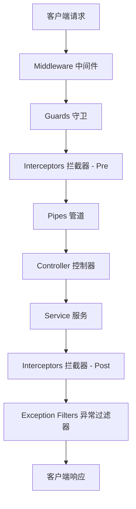

在构建复杂的后端系统时，某些功能往往会横跨多个模块，例如身份验证、日志记录、数据校验和响应格式化。如果将这些逻辑直接耦合在业务代码中，会导致代码冗余且难以维护。NestJS 通过引入面向切面编程（Aspect-Oriented Programming, AOP）的思想，提供了一套优雅的解决方案。

### 1. 核心概念：从 OOP 到 AOP

面向对象编程（OOP）通过封装、继承和多态来组织代码，解决了业务逻辑的模块化问题。然而，在企业级应用中，存在许多“横切关注点”（Cross-cutting Concerns），如权限校验、事务管理、性能监控等。这些功能不属于任何特定的业务逻辑，但却散落在各个模块中。

AOP 的出现正是为了解决这一痛点。它允许开发者将这些横切关注点从核心业务逻辑中分离出来，通过“切面”将其动态地织入到目标代码中。

**为什么 AOP 对企业级后端至关重要？**

- **解耦**：业务逻辑不再关心鉴权、日志等非业务功能。
- **复用**：通用的逻辑只需编写一次，即可应用到多个路由或控制器。
- **可维护性**：修改全局响应格式或鉴权逻辑时，只需调整对应的切面组件，无需遍历所有业务代码。

### 2. NestJS 请求生命周期全解析

理解 AOP 的关键在于掌握请求在 NestJS 内部的流转顺序。NestJS 的 AOP 架构由多个层次组成，每一层都有其特定的职责。



#### 生命周期各阶段职责：

1.  **Middleware (中间件)**：最先执行，通常用于处理底层的 HTTP 逻辑，如跨域处理（CORS）、请求体解析、静态资源服务等。它无法访问 NestJS 的执行上下文（ExecutionContext）。
2.  **Guards (守卫)**：用于权限判定。它在中间件之后、拦截器之前执行。守卫可以访问元数据，从而实现基于角色的访问控制（RBAC）或基于属性的访问控制（ABAC）。
3.  **Interceptors (拦截器 - Pre)**：在路由处理器执行前运行。它可以修改请求参数、记录开始时间或直接返回缓存数据。
4.  **Pipes (管道)**：主要用于数据转换和验证。它在拦截器之后、控制器之前执行。
5.  **Controller & Service**：核心业务逻辑执行层。
6.  **Interceptors (拦截器 - Post)**：在路由处理器执行后运行。利用 RxJS 的强大能力，它可以对响应数据进行格式化、记录操作日志或处理副作用。
7.  **Exception Filters (异常过滤器)**：最后一道防线。当请求处理过程中抛出异常时，过滤器会捕获它并返回统一的错误响应格式。

#### ExecutionContext：跨平台设计哲学

在 Guards 和 Interceptors 中，我们经常看到 `ExecutionContext` 的身影。为什么 NestJS 不直接传递原生的 `req` 或 `res` 对象？

这就是 NestJS 的**协议无关性 (Protocol Agnosticism)**。`ExecutionContext` 封装了当前执行过程的所有细节，它不仅支持传统的 HTTP 请求，还完美适配 WebSockets、微服务（gRPC/Kafka/RabbitMQ）以及 GraphQL。

通过 `ExecutionContext` 提供的工具方法，开发者可以轻松切换上下文：

- `context.switchToHttp()`：处理 REST API。
- `context.switchToWs()`：处理实时通信。
- `context.switchToRpc()`：处理微服务调用。

这种设计允许我们编写一套通用的权限守卫或日志拦截器，并将其无缝复用到不同的通信协议中，实现了真正的“一次编写，到处运行”。

### 3. 守卫 (Guards)：身份验证与权限控制

守卫的主要职责是根据运行时条件决定请求是否应继续。在 NestJS 中，守卫必须实现 `CanActivate` 接口。

#### AuthN (认证) vs AuthZ (授权)

- **Authentication (401 Unauthorized)**：确认“你是谁”。通常由 `JwtAuthGuard` 处理，校验 Token 的合法性。
- **Authorization (403 Forbidden)**：确认“你能做什么”。在确认身份后，由 `PoliciesGuard` 等组件校验用户是否具备操作特定资源的权限。

#### 实战案例：PoliciesGuard

在本项目中，`PoliciesGuard` 结合 CASL 实现了细粒度的权限校验。它通过 `Reflector` 读取路由上的权限元数据，并校验当前用户是否具备相应权限。

```typescript
@Injectable()
export class PoliciesGuard implements CanActivate {
  constructor(
    private reflector: Reflector,
    private caslAbilityFactory: CaslAbilityFactory,
    private userService: UserService,
  ) {}

  async canActivate(context: ExecutionContext): Promise<boolean> {
    // 1. 提取路由上定义的权限处理器
    const policyHandlers =
      this.reflector.get<PolicyHandler[]>(
        CHECK_POLICIES_KEY,
        context.getHandler(),
      ) || [];

    const request = context.switchToHttp().getRequest();
    const jwtUser = request.user;
    if (!jwtUser) return false;

    // 2. 获取完整的用户信息（包含角色和权限）
    const user = await this.userService.findUserProfile(jwtUser.id);
    if (!user) return false;

    // 3. 构建 CASL 能力对象
    const ability = this.caslAbilityFactory.createForUser(user);
    request.ability = ability;

    // 4. 校验所有权限策略
    const isAllowed = policyHandlers.every((handler) =>
      typeof handler === "function"
        ? handler(ability)
        : handler.handle(ability),
    );

    if (!isAllowed) {
      throw new ForbiddenException("您没有执行此操作的权限");
    }
    return true;
  }
}
```

### 4. 拦截器 (Interceptors)：AOP 的核心

拦截器是 NestJS AOP 中最强大的组件。它基于 RxJS 的 `Observable`，允许我们在函数执行前后绑定逻辑。

#### 核心原理：next.handle()

`intercept` 方法接收一个 `CallHandler`。调用 `next.handle()` 会触发后续的生命周期（管道、控制器等）。它返回一个 `Observable`，代表了响应流。

#### 实战案例 1：统一响应格式 (TransformInterceptor)

为了保证前端接收到的数据结构一致，我们使用 `map` 操作符包装所有成功的响应。

```typescript
@Injectable()
export class TransformInterceptor<T> implements NestInterceptor<
  T,
  Response<T>
> {
  intercept(
    context: ExecutionContext,
    next: CallHandler,
  ): Observable<Response<T>> {
    return next.handle().pipe(
      map((data) => ({
        code: 0,
        message: "success",
        data: data === undefined ? null : data,
      })),
    );
  }
}
```

#### 实战案例 2：操作日志记录 (OperationLogInterceptor)

通过 `tap` 记录成功日志，通过 `catchError` 记录失败日志。

```typescript
@Injectable()
export class OperationLogInterceptor implements NestInterceptor {
  intercept(context: ExecutionContext, next: CallHandler): Observable<unknown> {
    const metadata = this.reflector.get<OperationLogMetadata>(
      OPERATION_LOG_KEY,
      context.getHandler(),
    );

    if (!metadata) return next.handle();

    const request = context.switchToHttp().getRequest();
    const startTime = Date.now();

    return next.handle().pipe(
      tap(() => {
        const duration = Date.now() - startTime;
        this.saveLog(request, metadata.description, "SUCCESS", duration);
      }),
      catchError((error) => {
        const duration = Date.now() - startTime;
        this.saveLog(request, metadata.description, "FAIL", duration, error);
        return throwError(() => error);
      }),
    );
  }
}
```

### 5. 装饰器与 Reflector：元数据的桥梁

AOP 组件通常需要知道它们正在处理哪个路由。通过自定义装饰器，我们可以将元数据附加到方法上。

#### SetMetadata 与自定义装饰器

```typescript
// 定义操作日志装饰器
export const OperationLog = (description: string) =>
  SetMetadata(OPERATION_LOG_KEY, { description });

// 定义权限校验装饰器
export const CheckPolicies = (...handlers: PolicyHandler[]) =>
  SetMetadata(CHECK_POLICIES_KEY, handlers);
```

#### Reflector 的高级用法

- **reflector.get**：获取当前处理器或类上的元数据。
- **reflector.getAllAndOverride**：在类和方法上同时定义元数据时，优先使用方法上的定义（覆盖模式）。这在定义“公开路由”时非常有用，例如在 Controller 上定义了 `JwtAuthGuard`，但在特定方法上使用 `@Public()` 覆盖它。

### 6. 管道 (Pipes)：数据转换与校验

管道是 AOP 在数据层面的体现。它在拦截器之后、控制器之前执行，主要承担两个职责：**转换 (Transformation)** 和 **校验 (Validation)**。

通过 `ValidationPipe` 结合 `class-validator`，NestJS 可以在请求到达业务逻辑之前，自动拦截不符合规范的数据并返回 `400 Bad Request`。这种“数据净化”机制确保了 Controller 接收到的永远是合法且类型安全的对象。

#### 实战案例：CreateUserDto

```typescript
import { IsString, IsEmail, MinLength } from "class-validator";

export class CreateUserDto {
  @IsString()
  @MinLength(3)
  username: string;

  @IsEmail()
  email: string;
}
```

在全局或路由级别启用 `ValidationPipe` 后，任何不符合上述规则的请求都将被 AOP 机制阻断，从而保护了核心业务逻辑的纯粹性。

### 7. 异常过滤器 (Exception Filters)：完成闭环

异常过滤器是 AOP 链路的终点。它捕获所有未处理的异常，并将其转换为标准化的 JSON 响应。

```typescript
@Catch(HttpException)
export class HttpExceptionFilter implements ExceptionFilter {
  catch(exception: HttpException, host: ArgumentsHost) {
    const ctx = host.switchToHttp();
    const response = ctx.getResponse();
    const status = exception.getStatus();

    response.status(status).json({
      code: status,
      message: exception.message,
      timestamp: new Date().toISOString(),
    });
  }
}
```

通过将 `HttpExceptionFilter` 与 `TransformInterceptor` 结合使用，我们可以确保无论请求成功还是失败，客户端接收到的数据结构始终是可预测的。

### 总结

通过合理使用 AOP，我们将鉴权、日志、格式化等非业务逻辑从 Controller 中剥离。这不仅使业务代码更加纯粹，也极大地增强了代码的可重用性和可测试性。在 NestJS 中，AOP 不仅仅是一个技术特性，更是一种构建健壮、可扩展架构的核心思维方式。
